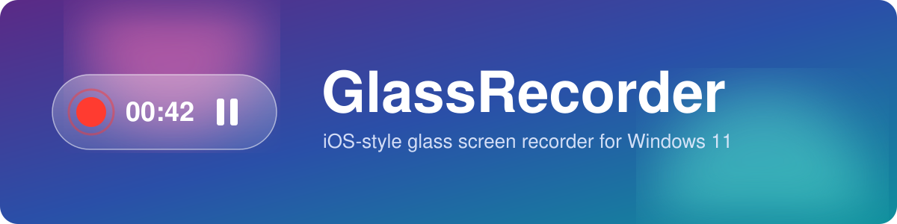
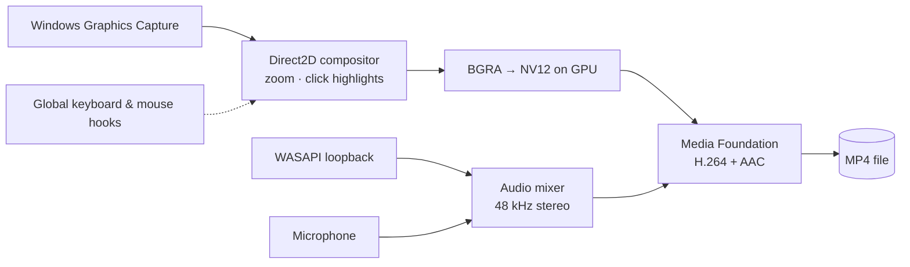

<p align="center">
  
</p>

<p align="center">
  <b>A lightweight screen recorder for Windows 11 with an iOS-style glass look.</b><br>
  Lives in the tray, records with hotkeys, encodes on your GPU and stays out of the video itself.
</p>

<p align="center">
  
  
  
  
  
</p>

<p align="center">
  <a href="https://github.com/the-volador42/GlassRecorder/releases/latest"><b>⬇ Download</b></a> •
  <a href="#-features">Features</a> •
  <a href="#%EF%B8%8F-hotkeys">Hotkeys</a> •
  <a href="#-getting-started">Getting started</a> •
  <a href="#-how-it-works">How it works</a>
</p>

---

## ✨ Features

| | |
|---|---|
| 🖥️ **Full screen** | Records the chosen monitor. |
| 🪟 **Active window** | Records the focused window and **follows you** when you switch windows. |
| 🔊 **System audio + mic** | WASAPI loopback and microphone mixed to 48 kHz stereo. Mute the mic right during recording. |
| ⏸️ **Pause** | Pause and resume without splitting the file. |
| 🔍 **Zoom to cursor** | Smooth zoom toward the cursor while you hold the hotkey. |
| 🖱️ **Click highlights** | Left click shows a red circle, right click a green one. |
| ⚡ **GPU encoding** | H.264 on NVENC / AMD / Intel, with a CPU fallback. MP4 at 30 or 60 FPS. |
| 🫥 **Invisible UI** | The app's own windows never appear in the recording. |
| 🧊 **Glass design** | Windows 11 acrylic: a floating recording panel and a settings window in the style of iOS. |

---

## ⌨️ Hotkeys

Defaults. Any key chord can be reassigned in Settings.

| Action | Keys |
|---|---|
| Start recording | <kbd>F3</kbd> + <kbd>F2</kbd> |
| Stop and save | <kbd>F3</kbd> + <kbd>F4</kbd> |
| Pause / resume | <kbd>F3</kbd> + <kbd>P</kbd> |
| Microphone on / off | <kbd>F3</kbd> + <kbd>M</kbd> |
| Zoom to cursor (hold) | <kbd>F3</kbd> + <kbd>C</kbd> |
| Click highlights on / off | <kbd>F3</kbd> + <kbd>K</kbd> |

> [!NOTE]
> The <kbd>Fn</kbd> key is handled by the keyboard itself and is invisible to Windows, so it can't be part of a hotkey.

---

## 🚀 Getting started

### Download

<p>
  <a href="https://github.com/the-volador42/GlassRecorder/releases/latest">
    
  </a>
</p>

1. Download `GlassRecorder-…-win-x64.zip` from the [latest release](https://github.com/the-volador42/GlassRecorder/releases/latest).
2. Unzip it anywhere and run `GlassRecorder.exe`.
3. If Windows asks for .NET, install the [.NET 8 Desktop Runtime (x64)](https://dotnet.microsoft.com/download/dotnet/8.0).

### Build from source

#### Requirements

- Windows 10 2004+ or Windows 11 (x64)
- [.NET 8 SDK](https://dotnet.microsoft.com/download/dotnet/8.0) to build, or the .NET 8 Desktop Runtime to run

#### Build and run

```bash
git clone https://github.com/the-volador42/GlassRecorder.git
cd GlassRecorder
dotnet publish -c Release -o publish
publish\GlassRecorder.exe
```

The app goes straight to the tray. Click the tray icon to open Settings.

### Where things are

| What | Where |
|---|---|
| Videos | `%USERPROFILE%\Videos\GlassRecorder` |
| Settings and log | `%APPDATA%\GlassRecorder` |

### Self-test

```bash
GlassRecorder.exe --selftest 5 [--demo] [--window]
```

Records 5 seconds without the UI, to check capture and encoding on your machine.

---

## 🧩 How it works



| File | Role |
|---|---|
| [`Core/Recorder.cs`](Core/Recorder.cs) | Capture via Windows Graphics Capture, frame composition in Direct2D, frame loop |
| [`Core/MediaWriter.cs`](Core/MediaWriter.cs) | Media Foundation: BGRA → NV12 on the GPU, H.264 + AAC into MP4 |
| [`Core/AudioMixer.cs`](Core/AudioMixer.cs) | WASAPI loopback + microphone, mixed to 48 kHz stereo |
| [`Core/InputHooks.cs`](Core/InputHooks.cs) | Global keyboard hooks (chords of any keys) and mouse hooks |
| [`Core/CaptureSource.cs`](Core/CaptureSource.cs) | Monitor / window capture source |
| [`UI/`](UI) | Settings window, floating recording panel, glass effect (Windows 11 acrylic) |

Built with [NAudio](https://github.com/naudio/NAudio) and [Vortice.Windows](https://github.com/amerkoleci/Vortice.Windows) (Direct3D 11, Direct2D, Media Foundation).
